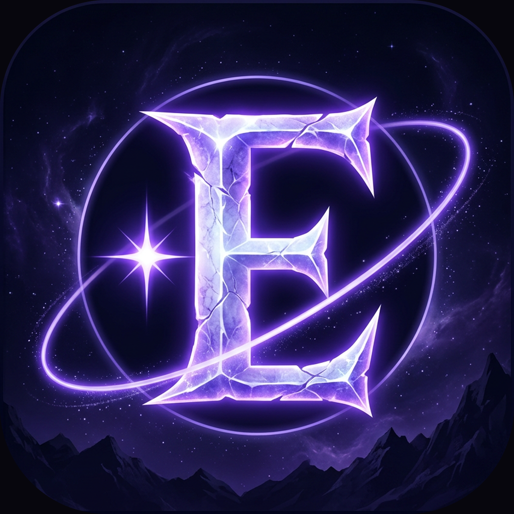

# Eternalz

A dark, cosmic personal toolkit for everyday things — built with Expo / React Native on top of [Appwrite](https://appwrite.io).

Created by **Waquar Shaikh**.

<p align="center">
  
</p>

## What's in it today

- **First-run tour** — four quick screens on first launch: what Eternalz is, who built it, the tools that are on the way, and where to find everything.
- **Dashboard (Home)** — brand masthead, live connection chip, stats, the featured roadmap, and your account state.
- **Document Manager** — the first live tool. Private, invite-only file rooms for families and small teams: store PDFs, photos, spreadsheets and documents, with on-device photo and PDF tools. [How it works](docs/VAULT.md) · [Setup guide](docs/SETUP.md).
- **Tools** — the full roadmap; live tools open when tapped, the rest show what they'll do. New tools appear here as they ship.
- **Settings** — your account, an **Appwrite connection test**, the roadmap count, and About.
- **Accounts** — sign up, log in, log out, persisted sessions, account details. Powered by Appwrite's Account service.

Everything is built to grow: the roadmap lives in one file, so adding a tool is a one-line change.

## Appwrite project

| | |
|---|---|
| Project name | Eternalz |
| Project ID | `6acf0e9b0034e6ac2483` |
| Endpoint | `https://tor.cloud.appwrite.io/v1` (Toronto region) |

These are baked into [`constants/appwrite.ts`](constants/appwrite.ts) so the app runs with no `.env` file; `EXPO_PUBLIC_APPWRITE_*` env vars override if you ever need them.

## Quick start

```bash
pnpm install
pnpm web        # browser
pnpm android    # Android device/emulator (needs adb + Expo Go)
pnpm ios        # iOS (macOS only)
```

Settings → **Test connection** pings Appwrite and shows the round-trip time, so you can confirm the project is wired correctly.

### Document Manager backend

The file rooms need a bucket, two tables and one function before they'll work. Two ways to do it — pick whichever suits you:

```bash
pnpm vault:setup    # creates everything; asks for an API key (never saved to disk)
pnpm vault:test     # 60 offline logic checks, no backend needed
```

…or create the resources by hand in the Appwrite console, no terminal at all. Both routes are covered step by step in **[docs/SETUP.md](docs/SETUP.md)**; it also includes where commands actually run, which is not inside Appwrite. Then open **Tools → Document Manager → Setup check** in the app to verify the backend.

> **Running on web?** The browser enforces CORS. If the connection test fails there, add a **Web platform** in the Appwrite console (Project → Platforms) for the host you're serving from. Android and iOS have no such rule.

## Verify without a device

```bash
npx tsc --noEmit   # typecheck
pnpm build         # web export — proves the app bundles
```

## Design language

Near-black void (`#07060D`) with electric violet (`#8B5CF6`) and lavender (`#C4B5FD`) accents. Glass panels over a slowly breathing gradient backdrop, gradient-ringed hero cards, staggered mount animations, and hand-drawn SVG icons (no icon font). The brand mark is vector, so it stays crisp at every size and sits on any background. Tokens live in [`theme/tokens.ts`](theme/tokens.ts).

## Layout

```
app/(tabs)/          Home, Tools, Settings
app/                 onboarding, login, signup, account, about
components/ui/       GlassCard, Button, Chip, TextField, Screen, ListRow, GlowBackground
components/          BrandMark, icons
context/             auth (Appwrite sessions), onboarding (first-run flag)
constants/           appwrite client + roadmap data + vault ids
services/vault/      Document Manager: groups, files, crypto, PDF + photo tools
components/vault/    FileCard, GroupCard
app/documents/       Document Manager screens
functions/join-group Appwrite Function: verifies invite codes server-side
scripts/             setup-appwrite.mjs, test-vault-logic.mjs
docs/                SETUP.md, VAULT.md
theme/               design tokens
skills/              vendored Appwrite agent skills
```

## Credits

Built with [Appwrite](https://appwrite.io), [Expo](https://expo.dev) and React Native. Agent context and conventions live in [AGENTS.md](AGENTS.md).
